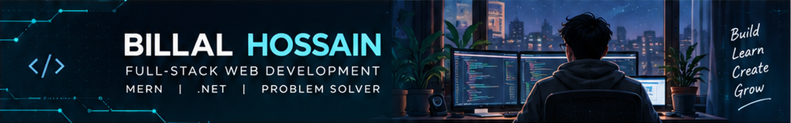

  

   

  <h1>Hi, I'm Billal Hossain 👋</h1>
  <h3>Computer Science Undergraduate | Aspiring Full-Stack Software Developer</h3>

  

    
    
    
  

  

    <a href="https://billalhossain404.github.io/my-portfolio/">Portfolio</a> •
    <a href="https://www.linkedin.com/in/billalhossainexe/">LinkedIn</a> •
    <a href="mailto:engr.billalhossainn@gmail.com">Email</a>
  

---

## 👨‍💻 About Me

I'm a Computer Science undergraduate from Bangladesh with a strong interest in **full-stack web development**, **MERN technologies**, and **C#/.NET application development**. I enjoy turning ideas into practical software projects while continuously improving my problem-solving, software design, and development skills.

I am currently building my portfolio and preparing for **internships, junior developer roles, and collaborative software projects**.

## 🚀 What I'm Working On

- 🔭 Building and improving projects with **React, Next.js, Node.js, and MongoDB**.
- 🌱 Learning **C#, ASP.NET Core, REST APIs, and enterprise application development**.
- 🧩 Practicing **data structures, algorithms, OOP, and clean-code principles**.
- 🤝 Exploring collaborative projects and software development opportunities.

---

## 🛠️ Skills & Technologies

  
<strong>Programming Languages</strong>

   
  

    
  

  
<strong>Frontend</strong>

   
  

    
  

  
<strong>Backend & Databases</strong>

   
  

    
  

  
<strong>Development Tools</strong>

   
  

    
  

**Also exploring:** Better Auth • REST API design • Testing • Role-based access control • SQL • Software architecture

---

## 📌 Featured Projects

### 🎓 [CampusConnect](https://github.com/billalhossain404/capmusconnect)

A campus events and club-management web application with student, organizer, and administrator workflows. Includes authentication, event approvals, registration, attendance, and reporting.

**Tech:** PHP 8+ • Custom MVC • MySQL/MariaDB • JavaScript • AJAX • HTML/CSS  
**Source:** [GitHub Repository](https://github.com/billalhossain404/capmusconnect)  
**Live Demo:** Not publicly deployed

### 🏥 [Smart-Care](https://github.com/billalhossain404/Smart-Care)

A C# hospital-management application project featuring dedicated interface screens for different staff roles.

**Tech:** C# • .NET / Visual Studio  
**Source:** [GitHub Repository](https://github.com/billalhossain404/Smart-Care)  
**Live Demo:** Desktop project — no public web demo

> 📍 Explore the pinned repositories below for the projects I want to highlight.

---

## 📊 GitHub Insights

  
  
   
  

Language stats reflect public repository code, not proficiency levels. Stats are provided by third-party services and may occasionally be unavailable.

---

## 🌐 Let's Connect

  
  
  
  
  
  

<em>Building with curiosity. Learning with consistency.</em>

